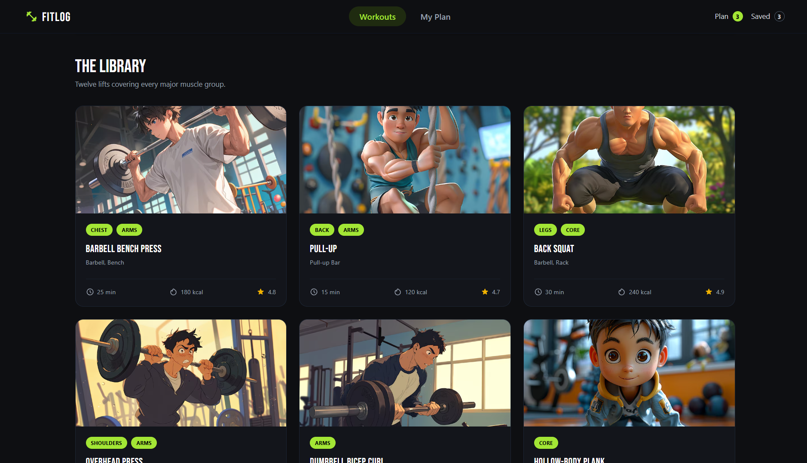
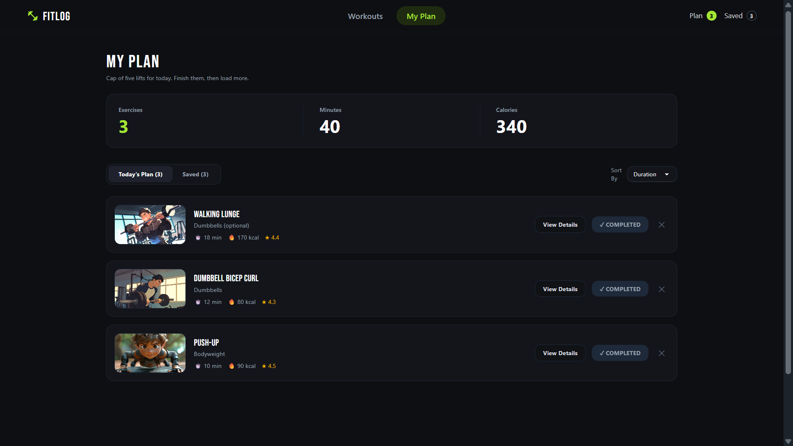
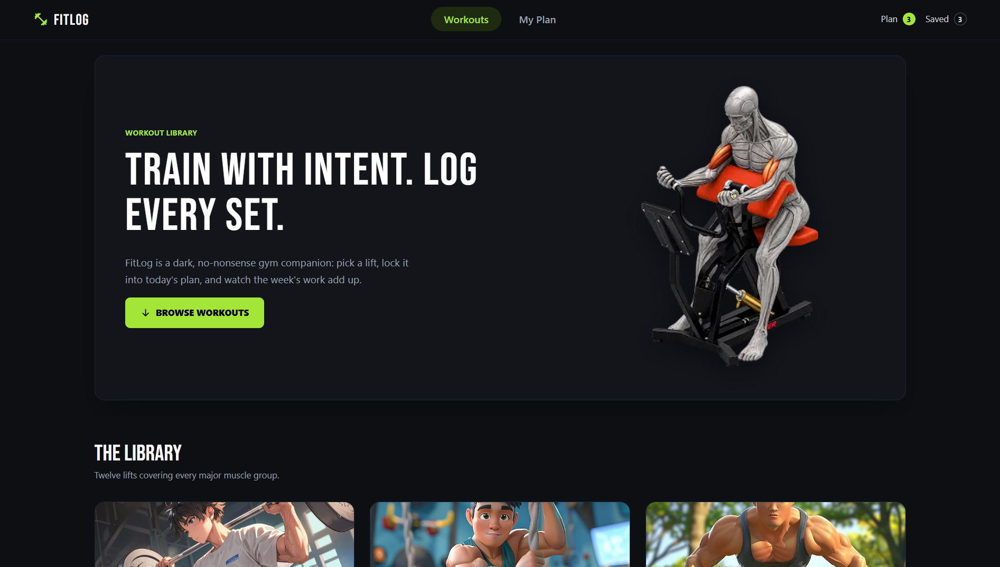
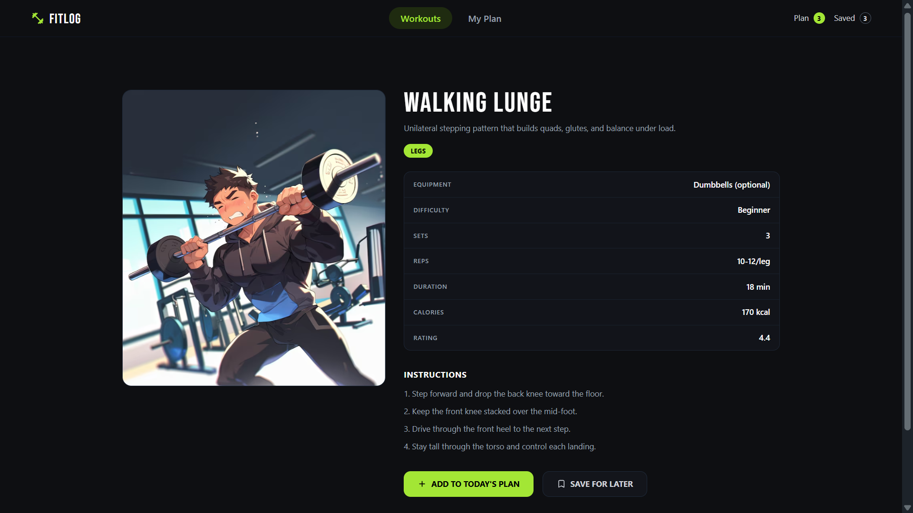
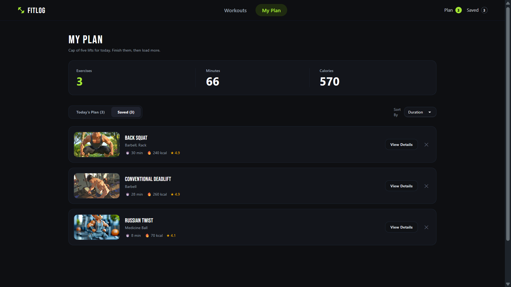
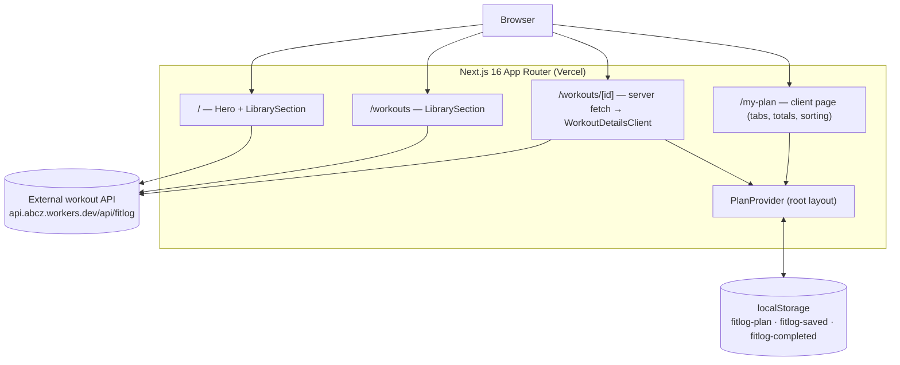

# FitLog


A dark, no-nonsense workout library and daily planning app. Browse twelve lifts, inspect their details, save favorites, and build a focused plan of up to five workouts — persisted locally, no account required.

## Overview

FitLog is a single Next.js application (App Router) that pulls workout data from an external read-only API and layers client-side planning state on top. Server components fetch and render the library; a React Context provider owns the user's plan and saved list, persisted to `localStorage` so state survives reloads.

There is no backend, database, or authentication in this repository — see [Project Architecture](#project-architecture).

## Key Features

- **Workout library** — responsive card grid with muscle-group tags, duration, calories, and star rating, fetched live on every request (`cache: "no-store"`)
- **Workout detail pages** — equipment, difficulty, sets/reps, duration, calories, rating, and step-by-step instructions; unknown IDs render the custom 404
- **Today's Plan** — cap of 5 workouts with duplicate and limit notifications, mark-as-done toggle, and remove
- **Saved workouts** — save lifts for later, independent of today's plan
- **Live totals** — exercise, minute, and calorie summaries for the active tab, plus plan/saved counters in the navbar
- **Sorting** — sort the plan or saved list by duration, calories, or rating
- **Persistence** — plan, saved list, and completion state survive page reloads via `localStorage`
- **Polish** — toast feedback (`react-hot-toast`), route-level loading states, custom 404 page, sticky responsive navigation with mobile dropdown

## Screenshots / Preview

**Home — hero and library entry**



**Workout library**



**Workout detail — stats, instructions, and actions**



**My Plan — Today's Plan tab with totals**



**My Plan — Saved tab**



## Live Demo

**https://fit-log-rk.vercel.app**

## Technology Stack

| Layer | Technology |
|---|---|
| Framework | Next.js 16.3.6 (App Router, Turbopack) |
| UI library | React 19.2.8 |
| Language | TypeScript 5 (strict mode) |
| Styling | Tailwind CSS 4 (CSS-first config) + DaisyUI 5 |
| State | React Context API + `localStorage` |
| Notifications | react-hot-toast |
| Compiler | React Compiler enabled (`babel-plugin-react-compiler`) |
| Linting | ESLint 9 flat config + `eslint-config-next` |
| Hosting | Vercel |

## Project Architecture



**Execution flow**

- **Server side:** `/`, `/workouts`, and `/workouts/[id]` are dynamic routes (`force-dynamic`, server-rendered on demand). They fetch from the external API with `cache: "no-store"`; failures degrade gracefully (empty library, or `notFound()` on the detail page).
- **Client side:** `PlanProvider` wraps the app in the root layout. All plan mutations (add/remove/complete) happen client-side and write through to `localStorage`.
- **Data contract:** the `Iworkout` interface in `src/types/index.ts` is the single source of truth for the API response shape.

### Routes

| Route | Rendering | Purpose |
|---|---|---|
| `/` | Dynamic | Hero banner + workout library |
| `/workouts` | Dynamic | Workout library only (re-exports `LibrarySection`) |
| `/workouts/[id]` | Dynamic | Workout detail; 404 for unknown IDs |
| `/my-plan` | Static (client) | Today's Plan and Saved tabs |
| `/_not-found` | Static | Custom 404 page |

## Folder Structure

```
a6-fit-log/
├── public/                    # Static assets (SVGs)
├── src/
│   ├── app/                   # App Router
│   │   ├── layout.tsx         # Root layout: Navbar, Footer, Toaster, PlanProvider
│   │   ├── page.tsx           # / → Hero + LibrarySection
│   │   ├── globals.css        # Tailwind 4 import + DaisyUI plugin
│   │   ├── not-found.tsx      # Custom 404
│   │   ├── my-plan/           # /my-plan page + loading state
│   │   └── workouts/
│   │       ├── page.tsx       # /workouts → LibrarySection
│   │       └── [id]/          # Detail page + WorkoutDetailsClient
│   ├── components/            # Hero, Navbar, Footer, LibrarySection, WorkoutCard, Loading
│   ├── context/PlanContext.tsx # Plan/saved state, business rules, localStorage persistence
│   ├── utils/api.ts           # Fetch helpers for the external API
│   ├── types/index.ts         # Iworkout schema
│   └── assets/                # banner.png, logo.png
├── eslint.config.mjs          # ESLint 9 flat config
├── next.config.ts             # React Compiler + image remote patterns
├── tsconfig.json              # Path alias: @/* → ./src/*
├── vercel.json                # Vercel install/build commands
└── package.json
```

## Installation & Setup

### Prerequisites

- **Node.js >= 20.9.0** (required by Next.js 16)
- npm (ships with Node; `package-lock.json` is committed — use `npm ci` for reproducible installs)

### Setup

```bash
git clone https://github.com/rezowan-kabir/a6-fit-log.git
cd a6-fit-log
npm install
npm run dev
```

Open http://localhost:3000. The app fetches workout data from a public API at runtime, so no additional services are needed.

## Environment Variables

**None required.** The project contains no `.env` files and no `process.env` references — the workout API base URL is hardcoded in `src/utils/api.ts` and `src/components/LibrarySection.tsx`.

If you introduce environment variables later, Next.js requires the `NEXT_PUBLIC_` prefix for values exposed to the browser.

## Backend, Database & Authentication

These do not apply to this repository:

- **Backend** — none. All workout data comes from an external, read-only, unauthenticated HTTP API (documented below).
- **Database** — none. User state (plan, saved workouts, completions) is stored in the browser's `localStorage` under the keys `fitlog-plan`, `fitlog-saved`, and `fitlog-completed`.
- **Authentication** — none. The app is fully public; state is per-device and per-browser.

## API Documentation

The app consumes a **third-party API** that is not part of this repository.

**Base URL:** `https://api.abcz.workers.dev/api/fitlog`

| Endpoint | Method | Parameters | Success response |
|---|---|---|---|
| `/api/fitlog` | `GET` | none | `200` — JSON array of workout objects (currently 12) |
| `/api/fitlog/{id}` | `GET` | `id` (path, integer) | `200` — single workout object; non-OK status makes the app return `null` and render the 404 page |

Requests are always sent with `cache: "no-store"` (no caching). The API requires no authentication and accepts no request body.

### Response schema

Matches the `Iworkout` interface (`src/types/index.ts`):

| Field | Type | Description |
|---|---|---|
| `id` | `number` | Unique workout ID |
| `name` | `string` | Workout name |
| `image` | `string` | Absolute image URL |
| `muscleGroups` | `string[]` | Target areas (e.g. `["Chest", "Arms"]`) |
| `equipment` | `string` | Equipment required |
| `difficulty` | `string` | `Beginner` \| `Intermediate` \| `Advanced` |
| `duration` | `number` | Minutes |
| `caloriesBurned` | `number` | Estimated kcal |
| `sets` | `number` | Prescribed sets |
| `reps` | `string` | Prescribed reps (may include ranges or time, e.g. `"6-8"`, `"30-45s"`) |
| `rating` | `number` | Average rating (1–5) |
| `description` | `string` | Short overview |
| `instructions` | `string[]` | Execution steps |

### Example — `GET /api/fitlog/1`

```json
{
  "id": 1,
  "name": "Barbell Bench Press",
  "image": "https://img.magnific.com/free-photo/...jpg?w=740",
  "muscleGroups": ["Chest", "Arms"],
  "equipment": "Barbell, Bench",
  "difficulty": "Intermediate",
  "duration": 25,
  "caloriesBurned": 180,
  "sets": 4,
  "reps": "6-8",
  "rating": 4.8,
  "description": "A compound press that builds chest thickness, triceps, and pressing power from a stable bench.",
  "instructions": [
    "Lie on the bench with eyes under the bar and feet planted.",
    "Unrack with locked elbows and lower the bar to mid-chest.",
    "Press up in a slight arc until elbows lock without bouncing.",
    "Keep shoulder blades pinched and a natural arch in the back."
  ]
}
```

## Available Scripts

| Command | Description |
|---|---|
| `npm run dev` | Start the development server (Turbopack) at http://localhost:3000 |
| `npm run lint` | Run ESLint over the project |
| `npm run build` | Production build — **also runs the TypeScript typecheck**; there is no separate `typecheck` script |
| `npm run start` | Serve the production build |

There is no test script or test framework in this project. Recommended verification before pushing: `npm run lint` → `npm run build`.

## Deployment Guide

Deployed on **Vercel**; `vercel.json` pins the build:

```json
{
  "installCommand": "npm install",
  "buildCommand": "npm run build"
}
```

To deploy your own copy:

1. Fork the repository.
2. Import it in the [Vercel dashboard](https://vercel.com/new) (or run `vercel` with the CLI) — defaults are picked up from `vercel.json`.
3. No environment variables or secrets are required.
4. Build command: `npm run build` · Install command: `npm install` · Node.js: 20.9+.

The pages are server-rendered on demand, so builds do not call the workout API. The deployed app needs outbound HTTPS access to `api.abcz.workers.dev` at request time.

## Security Considerations

- **No secrets in the repo** — the app has no environment variables, keys, or credentials.
- **Public, read-only API** — the workout API is fetched over HTTPS without authentication; it is a third-party dependency and a single point of failure (failures degrade to an empty library or the 404 page).
- **`localStorage` is untrusted, per-device storage** — plan data is not encrypted, not synced, and can be edited or cleared by the user. Stored JSON is parsed inside `try/catch`, but treat anything read from it as untrusted input.
- **Permissive image policy** — `next.config.ts` allows images from any HTTPS host (`remotePatterns: [{ protocol: "https", hostname: "**" }]`). Tighten this if the app ever renders user-supplied URLs.
- **No authorization model** — there are no protected routes or server mutations to secure today; adding a backend would change this.

## Future Improvements

_Suggestions, not implemented:_

- Search and filter the library by muscle group, equipment, or difficulty
- Move the API base URL into an environment variable for multi-environment deploys
- Add automated tests (unit + integration); none exist today
- Sync plan/saved state across devices (requires a backend and authentication)
- Offline support for previously viewed workouts
- Persist sorting/tab preferences alongside plan data

## Contributing

Contributions are welcome:

1. Fork the repository and create a feature branch (`git checkout -b feature/my-change`).
2. Keep changes focused and consistent with the existing code style.
3. Verify with `npm run lint` and `npm run build` — both must pass.
4. Open a pull request with a clear description of the change and motivation.

## License

No license file has been added to this repository yet. All rights are reserved by the author unless a license is specified — consider adding an MIT or Apache-2.0 `LICENSE` file if you intend open-source distribution.

## Author

**Rezowan Kabir** — [@rezowan-kabir](https://github.com/rezowan-kabir)

Repository: [github.com/rezowan-kabir/a6-fit-log](https://github.com/rezowan-kabir/a6-fit-log)
